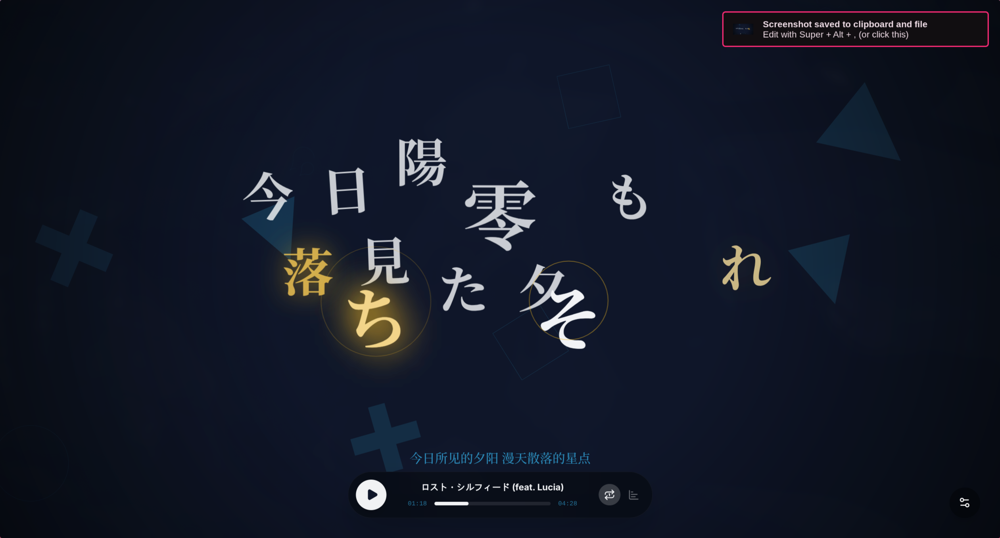
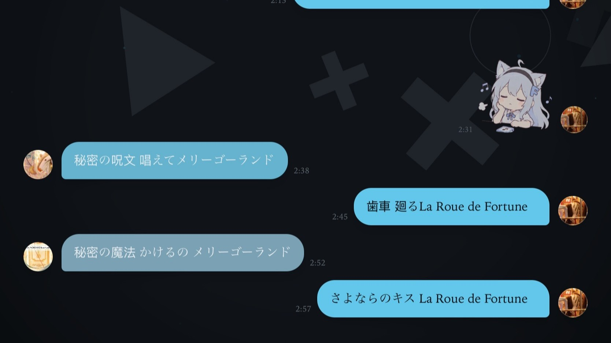

<p align="center">
  
</p>

<div align="center">
# Folia KTV

家庭 KTV // Home Karaoke

Folia KTV 是基于 Folia 桌面播放器改造的家庭 KTV 项目，保留原有在线音乐与歌词体验，并加入播放中逐段生成伴奏、原唱 / 伴奏切换、GPU 优先且自动回退 CPU 的人声分离，以及手机扫码加入局域网点歌。

**原作者与上游项目：** [@chthollyphile](https://github.com/chthollyphile) · [chthollyphile/folia-major](https://github.com/chthollyphile/folia-major)。本项目是社区改造版本，保留 Folia 的 AGPL-3.0 许可与上游署名；KTV 功能按本项目说明使用。感谢原作者及 Folia 社区。

[简体中文](README.md) | [English](README.en.md)


[](https://nodejs.org/)

[开发运行](#开发运行)
·
[家庭 KTV 使用说明](docs/ktv-home.md)
·
[上游 Folia 使用指南](https://folia-site.cielaniska.top/guide/)
·
[技术说明](docs/technical.md)

</div>

## 项目简介

Folia KTV 是以沉浸式歌词播放器为基础的家庭 KTV 桌面版。它支持网易云、酷狗、QQ 音乐、Navidrome 和本地音乐库等上游能力，并可在桌面播放期间为当前歌曲逐段生成伴奏，在原唱与已生成伴奏间切换。手机扫码页可加入局域网房间搜索并点歌，也可控制上一曲、下一曲、暂停和原唱 / 伴奏模式。

人声分离优先使用可用的 GPU 加速；GPU 不可用或推理失败时自动回退到 CPU。尚未生成的片段会继续播放原唱，处理速度取决于设备与音源。

KTV 播放与手机扫码点歌需要 Electron 桌面版。Web 版沿用上游 Folia 功能，不包含桌面局域网点歌服务。

## 开发运行

需要 Node.js 24 或更新版本。在项目目录运行：

```powershell
npm ci
npm run models:fetch
npm run dev:electron
```

`models:fetch` 会下载并校验人声分离模型。Windows 绿色版打包说明见 [portable package guide](packaging/windows/README-PORTABLE.txt)。本仓库提供源码；不要用上游 Folia 的安装包替代 KTV 版本。

## 展示


### 演示视频

https://github.com/user-attachments/assets/af806cf1-f67f-4b88-b2e7-57db507e9e81

https://github.com/user-attachments/assets/fd27f4f0-64b9-4c57-8c3b-10df767f934b

https://github.com/user-attachments/assets/704f195a-2194-434b-86e8-8f36290e5cc4

### 部分主题预览

<table>
  <tr>
    <td width="50%">
      
    </td>
    <td width="50%">
      
    </td>
  </tr>
  <tr>
    <td align="center"><strong>浮名</strong></td>
    <td align="center"><strong>流光</strong></td>
  </tr>
  <tr>
    <td width="50%">
      
    </td>
    <td width="50%">
      
    </td>
  </tr>
  <tr>
    <td align="center"><strong>心象</strong></td>
    <td align="center"><strong>云阶</strong></td>
  </tr>
  <tr>
    <td width="50%">
      
    </td>
    <td width="50%">
      
    </td>
  </tr>
  <tr>
    <td align="center"><strong>群唱</strong></td>
    <td align="center"><strong>倾诉</strong></td>
  </tr>
    <tr>
    <td width="50%">
      
    </td>
    <td width="50%">
      
    </td>
  </tr>
  <tr>
    <td align="center"><strong>镜台</strong></td>
    <td align="center"><strong>时计</strong></td>
  </tr>
</table>

不同的歌词动画具有不同的排版氛围和可调参数，让全屏歌词拥有如同文字PV般的丰富视觉效果，同时又能兼顾响应式布局，自动适配不同窗口尺寸。

## 核心能力

| 模块 | 说明 |
| --- | --- |
| 在线搜索与播放 | 搜索歌曲、歌手或专辑后即可播放，并自动加载相关封面与歌词。 |
| 本地音乐支持 | 可导入本地音频文件，在本地安全保存索引信息，不上传文件内容。详细用法见 [本地音乐库管理](docs/local-library-management.md)。 |
| 家庭 KTV | 桌面端可逐段生成当前歌曲伴奏并切换原唱；手机扫码后可在局域网内搜索并点歌。详见[家庭 KTV 使用说明](docs/ktv-home.md)。 |
| 智能歌词匹配 | 本地歌曲可自动匹配在线歌词与封面，也支持手动修正匹配结果。 |
| 本地歌词文件识别 | 自动加载同目录同名 `.lrc`、`.vtt`、`.ttml`、`.qrc`、`.yrc`、`.krc` 歌词文件，或歌词文件内嵌 LRC 歌词。适配 LDDC 生成的增强型逐字歌词格式。 |
| Now Playing 接入 | 支持通过本机 [Now Playing](https://github.com/Widdit/now-playing-service/) 服务接入外部播放器的歌曲、时间轴与歌词信息，并驱动 Folia 的舞台视图与全屏歌词渲染。 |
| AI 主题生成 | 基于歌曲情绪与歌词内容生成沉浸式背景与视觉参数。 |
| 多端体验 | 提供 Web 部署方式，同时支持桌面端打包分发。 |
| 模组系统（实验性） | 桌面版可通过 Folium 模组添加歌词动画、背景、播放页图层、命令等，并从 [模组市场](https://folium-compound.cielaniska.top) 安装官方认证的模组。详见 [模组系统](#模组系统folium-v1x)。 |

## 部署与发行

桌面版内置前后端运行环境，适合希望即装即用的用户。

### 一键部署

如果你希望部署继承自 Folia 的 Web 播放器，请阅读 [Vercel 部署指南](https://folia-site.cielaniska.top/guide/deploy-vercel)。此仓库的 KTV 播放和扫码点歌仅在桌面版提供。

项目也支持一键部署到 Cloudflare，请参考 Vercel 的部署教程进行相应调整。

Vercel 与 Cloudflare 上的 QQ 音乐不再需要额外部署一个常驻 API 实例：把 `VITE_QQ_API_BASE` 填成 `/api/qq`，再配一个 `QQ_SESSION_SECRET`（服务端密钥，**不加 `VITE_` 前缀**）即可。这种形态支持微信扫码和手机 QQ 扫码登录（手机 QQ 扫码要 qq-music-api 3.3.3 或更高版本），且播放前必须先登录；Cloudflare 上可以再绑定一个 Durable Object，让 QQ 扫码改走长连接，并多一个 QQ 音乐 App 扫码。完整步骤、平台差异和排错方法见 [QQ 音乐部署指南](docs/qq-music-deployment.md)。

自托管用户可以使用 [Docker Compose 全栈部署](deploy/docker/README.md)。本地音乐目录访问依赖可信 HTTPS 安全上下文，部署文档包含 NAS 反向代理和证书要求。

### 直接下载

本仓库当前提供源码，没有附带 Windows 绿色版二进制。请按上方开发步骤启动，或按 [Windows 绿色版打包说明](packaging/windows/README-PORTABLE.txt)自行构建。原版 Folia 的安装包不包含本项目的 KTV 改造。

Linux 包、Wayland / Hyprland 遥控窗和桌面端细节见 [技术与开发说明](docs/technical.md)。

### 移动端

| 方式 | 说明 |
| --- | --- |
| **PWA（推荐）** | 部署 Web 版本或自托管版本后，在 Chrome for Android / iOS Safari 中将网页添加到主屏幕，即可作为 PWA 应用使用。 |
| **社区移植版（Android）** | [maimai993/folia-sonnet](https://github.com/maimai993/folia-sonnet) · [whycfawa/folia-android](https://github.com/whycfawa/folia-android) |
| **自行打包（Android）** | 有一定技术基础的用户可以用 Capacitor 将 Web 版本打包为可安装的 APK，参考示范仓库 [chthollyphile/folia-sonnet](https://github.com/chthollyphile/folia-sonnet)。 |

> [!NOTE]
> 社区移植版均为第三方项目，由社区自发维护，功能会与官方 PC 版存在差异。使用中遇到问题请反馈到对应的社区仓库。

## 文档与开发

更完整的使用说明请访问 [Folia Guide](https://folia-site.cielaniska.top/guide/)。

部署、环境变量、本地开发、Stage API、常用脚本和技术栈见 [技术与开发说明](docs/technical.md)。

## 模组系统（Folium v1.x）

> [!NOTE]
> 模组系统是实验性功能，仅桌面版可用，默认关闭，需要在「设置 → 模组 → 模组系统」中开启。

Folium 是 Folia 的模组平台。模组可以添加新的歌词动画模式和背景类型、在播放页上叠加内容、给进度条加按钮和标记、注册命令与设置分区、在歌词显示前改写歌词，也可以通过 Node 入口调用 ffmpeg 等本地能力。模组以可信代码运行，每个模组在启用前都要在原生窗口中确认，文件变化后需要重新确认。

- **模组市场**：[folium-compound.cielaniska.top](https://folium-compound.cielaniska.top) 提供官方模组和经过审查的社区模组，下载 zip 后拖进模组面板即可安装。
- **官方认证**：市场里的模组都带有 Folium 签名，安装后显示「官方认证」；只通过安全审查的先行测试模组显示「先行测试」；没有签名的第三方模组显示「未验证」，同样可以使用。
- **开发与贡献**：[模组开发与贡献指南](docs/folium/contributing.md)，从写第一个模组、本地调试，到提交到模组市场、审查与签名、发布更新。
- **API 参考**：[Folium API 参考](docs/folium/api.md)，由契约文件生成的完整接口文档，按注册表、上下文、事件、服务等分类查询。
- **平台规范**：[Folium 规范](mods/README.md)，包括清单字段、权限、注册表语义、事件、安全模型与版本策略。
- **示范模组**：仓库的 [`mods/`](mods/) 目录，覆盖歌词动画、调参、进度条、播放页图层与透明视频导出。

## Sync Server

Folia 提供了可选的官方同步服务端 `sync-server`，用于在多个设备之间同步外观设置与 AI 主题库。服务端由用户自行托管，适合希望跨设备同步配色主题的用户。

支持以下部署方式：

- **Cloudflare Workers / D1**：免服务器运维的 Serverless 部署，推荐使用。
  [](https://deploy.workers.cloudflare.com/?url=https://github.com/chthollyphile/folia-major/tree/main/sync-server)
- **Docker**：镜像与 Compose 入口见 [Docker 部署目录](deploy/docker/README.md)。
- **Node.js 自托管**：使用 SQLite，适合本地或不方便使用 Docker 的环境。

详细的环境变量、Token 配置与部署步骤请参阅 [Sync-Server 部署指南](https://folia-site.cielaniska.top/guide/deploy-sync)。部署完成后，在 Folia 的「设置 → 连接与集成」中填写服务端地址和 `SYNC_TOKEN` 即可启用同步。

## 本地音乐与匹配说明

Folia 会读取音频文件元数据、同目录歌词和封面，并可通过网易云、QQ 音乐或酷狗音乐补全歌曲信息。自动匹配按网易云、QQ、酷狗依次回退；匹配不准确时，可以手动选择候选、恢复首次导入的本地信息，或进一步合并、拆分艺术家与专辑实体。

完整的导入、重扫、匹配、实体编辑、歌单、缓存和故障排查说明见 [本地音乐库管理](docs/local-library-management.md)。

## Community

加入discord社群，共同交流，获得帮助

[](https://discord.gg/dMDBTHxeKd)

## 贡献者

感谢所有为本项目进行 Issue 提交、Bug 报告、想法建议、测试与代码编写的贡献者，均依据 all-contributors 规范进行统计

由于列表过长，贡献记录请见 [贡献者名单](CONTRIBUTORS.md)。

## 法律与免责声明

本项目在 AI 的广泛协助下开发，因此仍可能存在细微或不易察觉的问题。若给你带来不便，敬请理解。

本项目主要用于展示播放动效、界面设计与相关工程实现。应用中涉及的在线音乐流媒体、歌词、专辑封面及其他内容，其版权均归对应权利人所有。

本仓库及其源代码仅供个人学习、技术交流与非营利测试使用。请勿将其用于商业盈利用途。若因对在线资源的传播、加工或再分发而引发版权纠纷或其他责任，均由使用者自行承担，项目开发者不承担相关责任。

请始终尊重数字版权，并在条件允许时通过官方平台支持正版音乐。

## 致谢

特别感谢以下项目和资源：

- [chenmozhijin/LDDC](https://github.com/chenmozhijin/LDDC)
- [NeteaseCloudMusicApiEnhanced](https://github.com/NeteaseCloudMusicApiEnhanced/api-enhanced)
- [chenglou/pretext](https://github.com/chenglou/pretext)
- [MakcRe/KuGouMusicApi](https://github.com/MakcRe/KuGouMusicApi)
- [paper-design/shaders](https://github.com/paper-design/shaders)
- [yakult-green-tea/qq-music-api](https://github.com/yakult-green-tea/qq-music-api)

本项目接入了 [Apple Music-like Lyrics TTML 逐词歌词库](https://github.com/amll-dev/amll-ttml-db) 以提供高质量的歌词文件，感谢此歌词库的作者和贡献者们。

## 许可证

本项目基于 `AGPL-3.0` 许可证开源。
